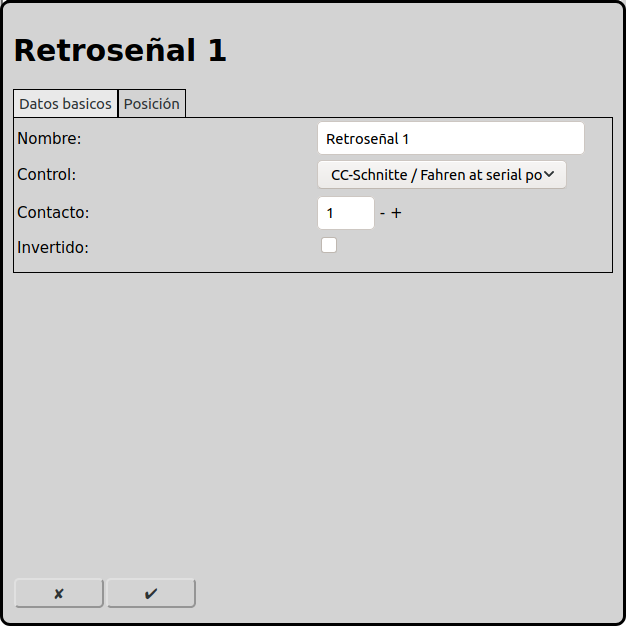
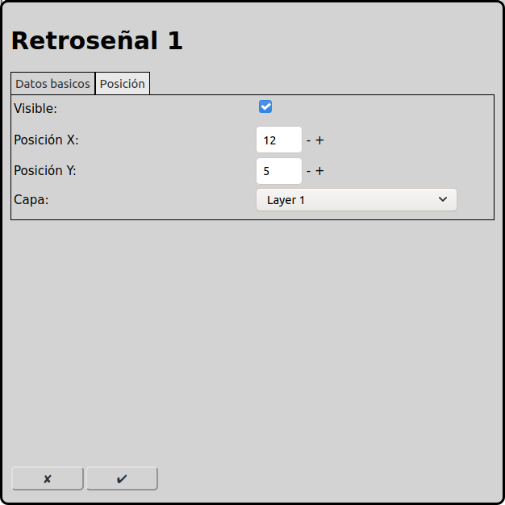

# Configuración de las retroseñales
En la pantalla principal se puede ir a la configuración de las retroseñales con el icono .

Las retroseñales son necesarias en la operación automática para detectar la posición de los trenes. Así RailControl puede parar los trenes cuando han llegado a su destino.

## Datos básicos

### Nombre
Cada retroseñal necesita un nombre inequívoco. Si el nombre no está indicado, RailControl crea un nombre. Si el nombre ya existe, RailControl añade un número al nombre para hacerlo inequívoco.

### Control
Si hay más de un control configurado en RailControl, se tiene que seleccionar el control que controla la retroseñal. Si solamente hay un control configurado en RailControl, el campo de selección no está visible.

### Contacto
El número del contacto físico. La mayoría de los controles empiezan a numerar con uno. Algunos controles usan algoritmos complicados para los números de los contactos. Consulte la documentación del control y/o de las retroseñales.

Cuando no está claro qué contacto físico tiene qué número, se puede activar "Añadir retroseñales desconocidas automáticamente" en las [opciones generales](#opciones-generales). Con eso RailControl añade las retroseñales desconocidas automáticamente. Después, las retroseñales están visibles en la capa del control.

### Invertido
Se puede invertir la lógica de las retroseñales. Normalmente una retroseñal cerrada se interpreta como activa. Si una retroseñal abierta debe interpretarse como activa, se puede invertir aquí.

## Posición

### Visible
Se puede mostrar una retroseñal en el diagrama de vías o no. Cuando una retroseñal está asociada a una vía, el estado acumulado de todas las retroseñales se muestra en la vía. En este caso se puede hacer invisible la retroseñal. En todos los casos, las retroseñales están visibles en la capa del control.

Cuando una retroseñal no está visible, los campos próximos también están invisibles.

### Posición X
La posición del elemento en cuadros desde la izquierda en el diagrama de vías. Se empieza a contar con cero.

### Posición Y
La posición del elemento en cuadros desde arriba en el diagrama de vías. Se empieza a contar con cero.

### Capa
La capa en que el elemento está visible.

