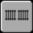
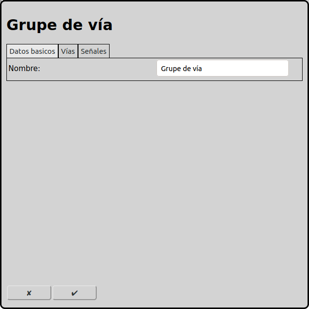
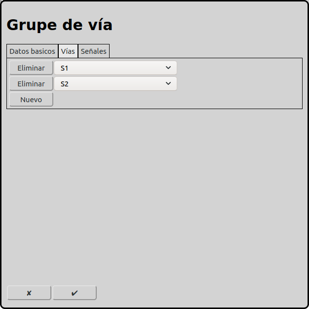

# Configuración de los grupos de vía
En la pantalla principal se puede ir a la configuración de los grupos de vía con el icono .

Los grupos de vía tienen efecto solamente en el modo automático. A todas las vías de un grupo de vía se puede entrar solamente desde un lado. Dos trenes no pueden entrar en una línea de vías desde ambos lados. Pero es posible que un tren siga a otro tren en la misma línea y en la misma orientación.

## Datos básicos

### Nombre
Cada grupo de vías necesita un nombre inequívoco. Si el nombre no está indicado, RailControl crea un nombre. Si el nombre ya existe, RailControl añade un número al nombre para hacerlo inequívoco.

## Vías

Se puede seleccionar todas las vías que son parte del grupo de vías.

## Señales
Obsoleto. Solamente se muestra si ya hay señales configuradas. Se eliminará en versiones futuras.

