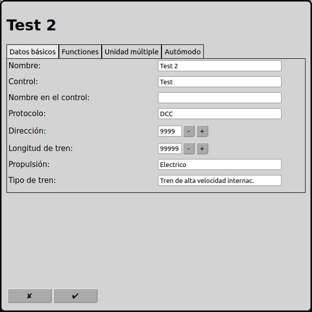
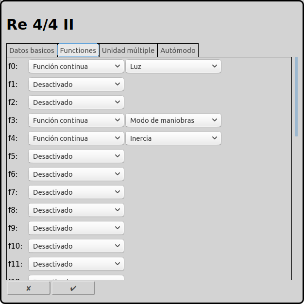
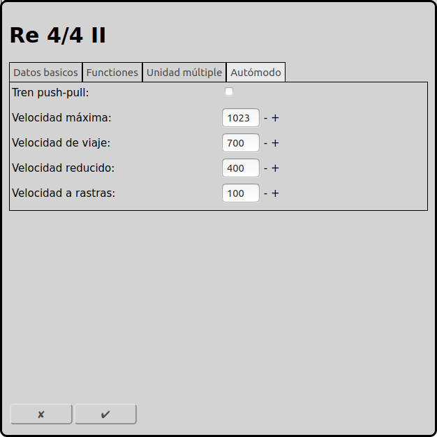

# Configuración de las locomotoras
Cada locomotora en la maqueta tiene que estar configurada para ser controlada por RailControl.

En la pantalla principal se puede ir a la configuración de las locomotoras con el icono . Otra posibilidad es usar el icono  en la locomotora seleccionada.

## Datos básicos

### Nombre
El nombre de la locomotora es la identificación única. El mismo nombre sólo puede usarse una vez. Algunos controles usan el nombre para sincronizar la base de datos de las locomotoras (por ejemplo Märklin CS2/CS3).

### Control
Si hay más de un control configurado en RailControl, se tiene que seleccionar el control que controla la locomotora. Si solamente hay un control configurado en RailControl, el campo de selección no está visible.

### Protocolo
Si un control soporta más de un protocolo, se tiene que seleccionar el protocolo que controla la locomotora. Si el control solamente soporta un protocolo, el campo de selección no está visible.

### Dirección
La dirección que controla la locomotora.

### Longitud del tren
Longitud del tren, preferiblemente en cm. Se usa en el modo automático para decidir si un tren puede entrar en un itinerario o en una vía de destino.

### Propulsión
La propulsión del tren. Se usa en el modo automático para decidir si un tren puede usar un itinerario.

### Tipo de tren
El tipo del tren. Se usa en el modo automático para decidir si un tren puede usar un itinerario.

## Funciones

Según el decodificador de la locomotora, se pueden asignar hasta 32 funciones por locomotora. Siempre se cuenta desde cero.

### Tipo
RailControl conoce dos tipos de funciones: la función permanente y la función de instantánea.

Se puede activar la función permanente con un clic y desactivarla con un segundo clic. Es para la luz, el sonido de conducción, el modo de maniobra y otras acciones permanentes.

La función de instantánea está activa durante el clic. Es para el claxon, desacoplar, anuncios de voz y control de grúa.

### Símbolo
En RailControl hay varios símbolos disponibles para seleccionar.

## Modo automático

### Tren push-pull
Un tren push-pull puede circular en ambas direcciones. En el modo automático RailControl puede cambiar la dirección de marcha. Si el tren push-pull no está seleccionado, RailControl no cambia la dirección de marcha.

### Velocidad máxima
Se puede ajustar la velocidad máxima. Es importante en el modo manual. Si se cambia la velocidad desde el control se puede exceder la velocidad máxima.

### Velocidad de viaje
Es la velocidad que RailControl usa normalmente en el modo automático.

### Velocidad reducido
Es la velocidad que RailControl usa en el modo automático cuando se alcanza la primera retroseñal.

### Velocidad a rastas
Es la velocidad que RailControl usa en el modo automático cuando se alcanza la segunda retroseñal.

