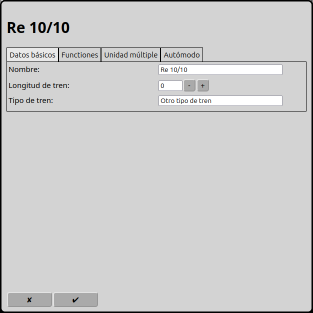
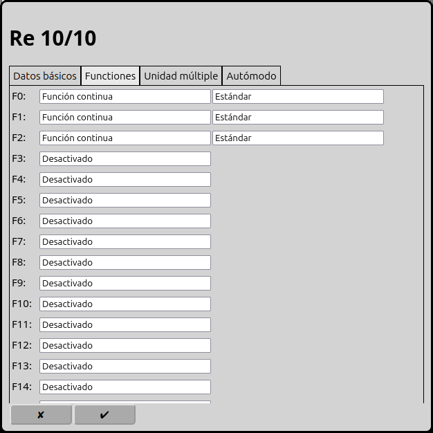
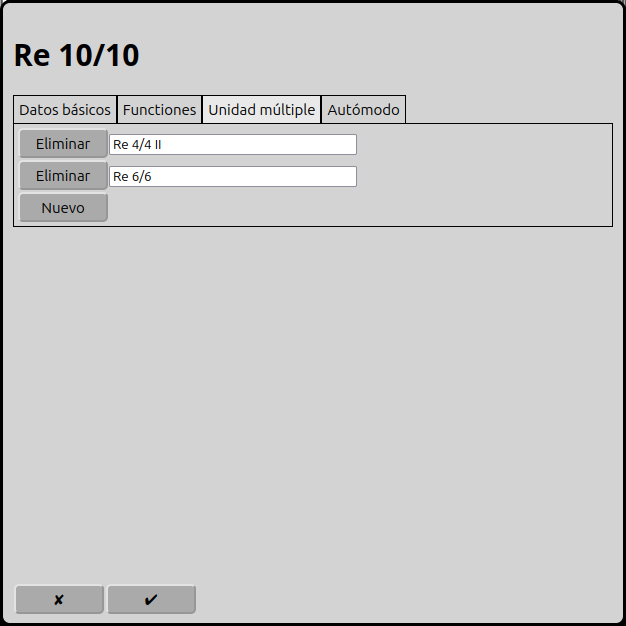
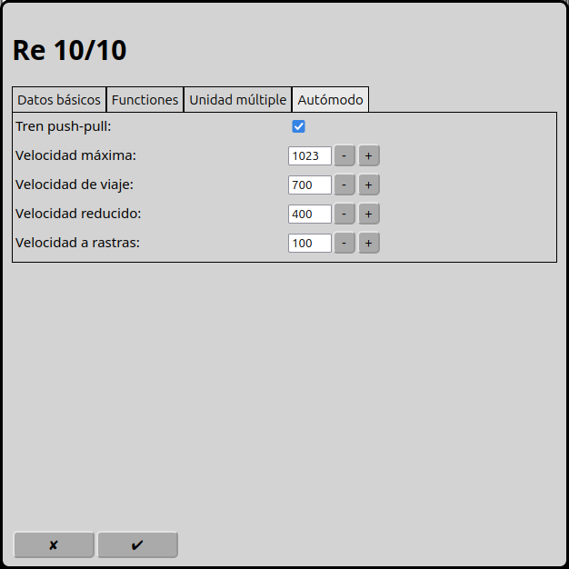

# Configuración de las unidades múltiples
RailControl soporta unidades múltiples. Para ello, todas las locomotoras deben circular a la misma velocidad en el mismo nivel de marcha. Además, todas las locomotoras deben conocer la orientación absoluta y tener el mismo número de niveles de velocidad. Märklin Motorola 1, en particular, no conoce la orientación absoluta.

En la pantalla principal se puede ir a la configuración de las unidades múltiples con el icono . Otra posibilidad es usar el icono  en la unidad múltiple seleccionada.

## Datos básicos

### Nombre
El nombre de la unidad múltiple es la identificación única. El mismo nombre sólo puede usarse una vez.

### Longitud del tren
Longitud del tren, preferiblemente en cm. Se usa en el modo automático para decidir si un tren puede entrar en un itinerario o en una vía de destino.

### Tipo de tren
El tipo del tren. Se usa en el modo automático para decidir si un tren puede usar un itinerario.

## Funciones

Según los decodificadores de las locomotoras, se pueden asignar hasta 32 funciones por locomotora. Siempre se cuenta desde cero. Las funciones usadas se reenvían a todas las locomotoras.

### Tipo
RailControl conoce dos tipos de funciones: la función permanente y la función de instantánea.

Se puede activar la función permanente con un clic y desactivarla con un segundo clic. Es para la luz, el sonido de conducción, el modo de maniobra y otras acciones permanentes.

La función de instantánea está activa durante el clic. Es para el claxon, desacoplar, anuncios de voz y control de grúa.

### Símbolo
En RailControl hay varios símbolos disponibles para seleccionar.

## Unidades múltiples

Se pueden añadir locomotoras a esta unidad múltiple. Después, todas las locomotoras se comportan de la misma manera.

## Modo automático

### Tren push-pull
Un tren push-pull puede circular en ambas direcciones. En el modo automático RailControl puede cambiar la dirección de marcha. Si el tren push-pull no está seleccionado, RailControl no cambia la dirección de marcha.

### Velocidad máxima
Se puede ajustar la velocidad máxima. Es importante en el modo manual. Si se cambia la velocidad desde el control se puede exceder la velocidad máxima.

### Velocidad de viaje
Es la velocidad que RailControl usa normalmente en el modo automático.

### Velocidad reducido
Es la velocidad que RailControl usa en el modo automático cuando se alcanza la primera retroseñal.

### Velocidad a rastas
Es la velocidad que RailControl usa en el modo automático cuando se alcanza la segunda retroseñal.

