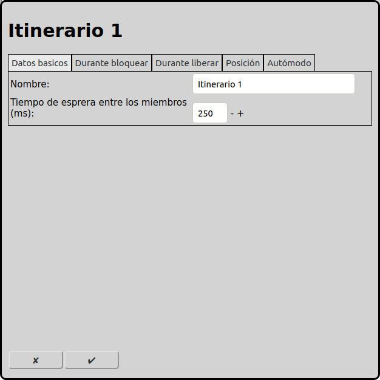
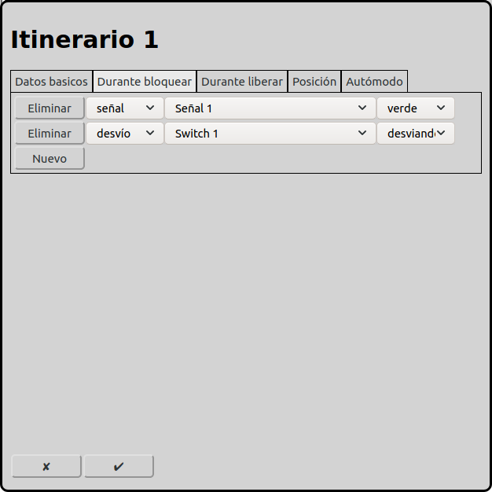
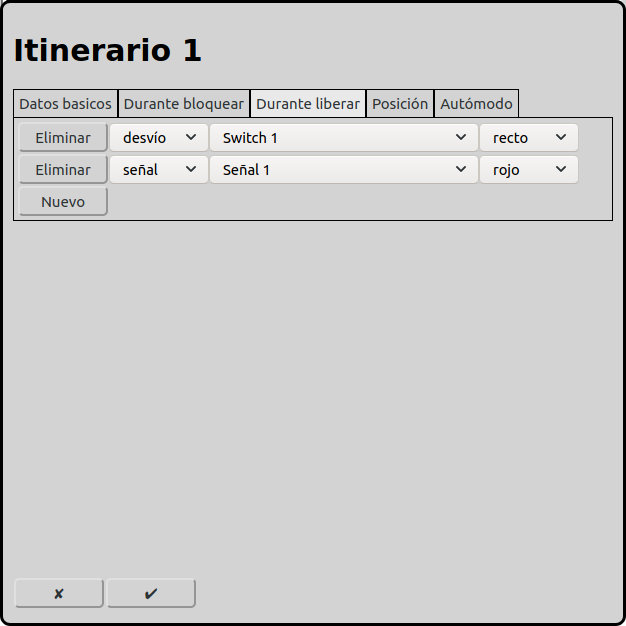
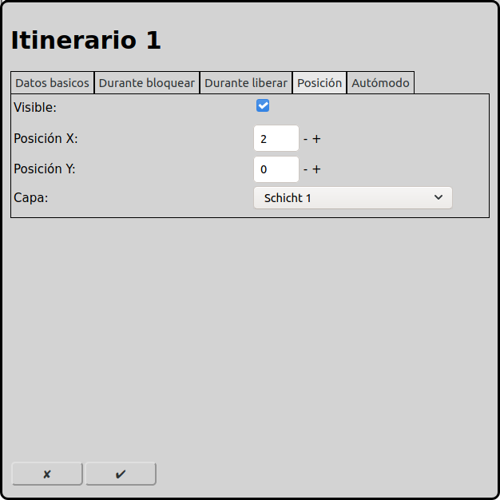
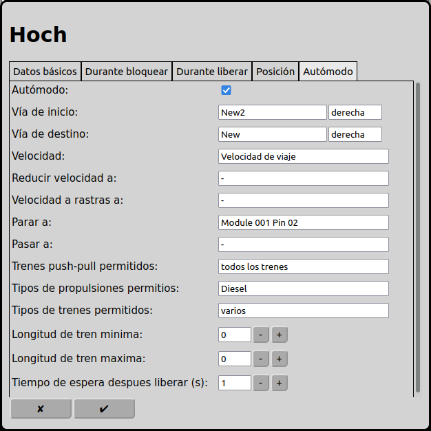

# Configuración de los itinerarios
En la pantalla principal se puede ir a la configuración de los itinerarios con el icono .

## En general
### Modo manual
En modo manual se pueden usar itinerarios para cambiar el estado de varios elementos con un clic. Los elementos pueden ser desvíos, señales y accesorios.

### Modo automática
En modo automática, los itinerarios son los elementos más importantes. Los trenes siempre circulan en itinerarios de una vía de inicio a una vía de destino. Todos los elementos intermedios (desvíos, señales, vías y accesorios) deben registrarse en la pestaña "Durante bloquear". Estos elementos están reservados para el tren que circula por la ruta. Entonces otros trenes ya no pueden usar estos elementos. Cuando el tren ha alcanzado la vía de destino, la vía de inicio y todos los elementos intermedios se liberan y otros trenes pueden usarlos.

En modo automática, RailControl puede cambiar el estado de los elementos cuando el tren alcanza la vía de destino (pestaña "Durante liberar").

## Datos básicos

### Nombre
Cada ruta necesita un nombre inequívoco. Si el nombre no está rellenado, RailControl crea un nombre. Si el nombre ya existe, RailControl añade un número al nombre para hacerlo inequívoco.

### Tiempo de espera entre los miembros (ms)
No se pueden operar los elementos registrados en las pestañas "Durante bloquear" y "Durante liberar" al mismo tiempo. Se tiene que seleccionar el tiempo entre la modo de los elementos para que el primer elemento haya terminado de cambiar de estado antes de operar el segundo. Así solamente un elemento requiere corriente eléctrica al mismo tiempo. Los accionamientos magnéticos solamente necesitan poco tiempo (alrededor de 100ms); en cambio, los accionamientos con motores y servos necesitan más tiempo (dependiendo del modelo y de la configuración del decodificador, hasta un segundo).

## Durante bloquear

Aquí se pueden registrar desvíos, señales, accesorios, vías y funciones de locomotoras.

En modo manual, cuando la ruta se opera con un clic del ratón, los desvíos, señales y accesorios se operan según el estado registrado. Las vías y funciones de locomotoras no tienen efecto en modo manual.

En modo automática, cuando el itinerario es operado por la locomotora, todos los elementos registrados en "Durante bloquear" están reservados. Entonces estos elementos no pueden usarse por modo manual ni por otros trenes en modo automática. Después se opera el estado registrado de todos los elementos. Cuando la locomotora ha alcanzado la vía de destino, todos los elementos se liberan y pueden ser usados por otros itinerarios u operados manualmente.

## Durante liberar

Aquí se pueden registrar desvíos, señales, accesorios, vías y funciones de locomotoras.

En modo manual, cuando el itinerario se opera con un clic del ratón, estos elementos no se tienen en cuenta.

En modo automática, cuando el itinerario es operado por la locomotora y el tren ha alcanzado la vía de destino, todos los elementos registrados se operan al estado registrado.

## Posición

### Visible
Se puede mostrar un itinerario en el diagrama de vías o no. Cuando el itinerario solamente se usa en modo automática, se puede hacer invisible el icono. Solamente los itinerarios usados en modo manual necesitan ser visibles.

Cuando un itinerario no está visible, los campos próximos también están invisibles.

### Posición X
La posición del elemento en cuadros desde la izquierda en el diagrama de vías. Se empieza a contar con cero. Si un elemento es más grande que un cuadrado, el cuadrado superior izquierdo es importante para contar.

### Posición Y
La posición del elemento en cuadros desde arriba en el diagrama de vías. Se empieza a contar con cero. Si un elemento es más grande que un cuadrado, el cuadrado superior izquierdo es importante para contar.

### Capa
La capa en que el elemento está visible.
 
## Modo automático

### Modo automático
Cuando un itinerario se usa en modo automático, se puede seleccionar aquí.

Cuando un itinerario se usa solamente en modo manual, los campos próximos están invisibles.

### Vía de inicio
Un tren en modo automático empieza su viaje en una vía de inicio. También se tiene que seleccionar la orientación con la que el tren sale de la vía de inicio.

### Vía de destino
Un tren en modo automático termina su viaje en una vía de destino. También se tiene que seleccionar la orientación con la que el tren llega a la vía de destino.

### Velocidad
La velocidad que usa un tren para circular por el itinerario. Si un desvío está en estado desviado, el tren puede usar una velocidad reducida.

### Reducir velocidad a
Si el tren alcanza esta retroseñal, la velocidad del tren se reduce si no hay preparado un itinerario siguiente. La selección de esta retroseñal es opcional.

### Velocidad a rastras a
Si el tren alcanza esta retroseñal, la velocidad del tren se reduce a la velocidad a rastras si no hay preparado un itinerario siguiente. La selección de esta retroseñal es opcional.

### Parar a
Si el tren alcanza esta retroseñal, el tren se detiene si no hay preparado un itinerario siguiente. La selección de esta retroseñal es obligatoria.

### Pasar a
Si el tren alcanza esta retroseñal, RailControl apaga la corriente eléctrica si no hay preparado un itinerario siguiente. Esta retroseñal es un instrumento adicional para prevenir accidentes si un tren no se detiene en el lugar deseado. La selección de esta retroseñal es opcional.

### Trenes push-pull permitidos
Todos los trenes: Todos los trenes pueden usar este itinerario.

Ningún tren push-pull: Los trenes push-pull no tienen permitido usar este itinerario.

Solamente trenes push-pull: Solamente los trenes push-pull tienen permitido usar este itinerario.

### Tipos de propulsiones permitidos
Se pueden definir restricciones sobre qué trenes pueden usar un itinerario. Por ejemplo, un tren eléctrico no puede entrar en una vía no electrificada, o un tren de vapor no puede entrar en una vía subterránea.

### Tipos de trenes permitidos
Se pueden definir restricciones sobre qué trenes pueden usar un itinerario. Por ejemplo, un tren de pasajeros debe ir a la estación de pasajeros y un tren de carga debe ir a la estación de carga.

### Longitud de tren mínima
La longitud mínima que un tren debe tener para usar este itinerario. La longitud del tren puede registrarse en las opciones de las locomotoras.

### Longitud de tren máxima
La longitud máxima que un tren puede tener para usar este itinerario. La longitud del tren puede registrarse en las opciones de las locomotoras.

### Tiempo de espera después de liberar (s)
Cuando un tren alcanza la vía de destino, tiene que esperar este tiempo en segundos. Después el tren puede continuar su viaje por el itinerario siguiente en modo automático. Un valor de 0 significa que el tren no tiene que esperar y puede seguir inmediatamente.

