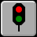
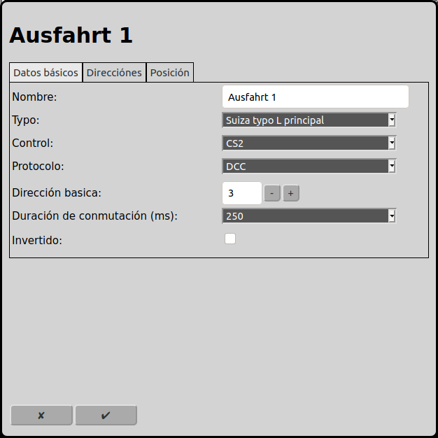
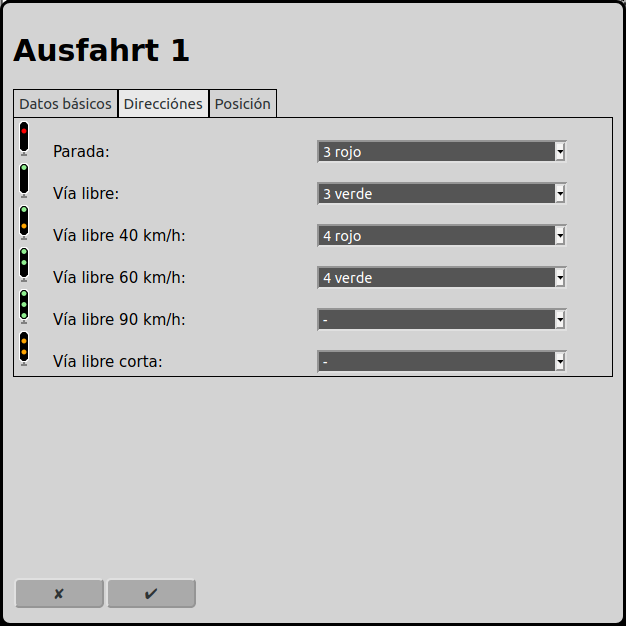
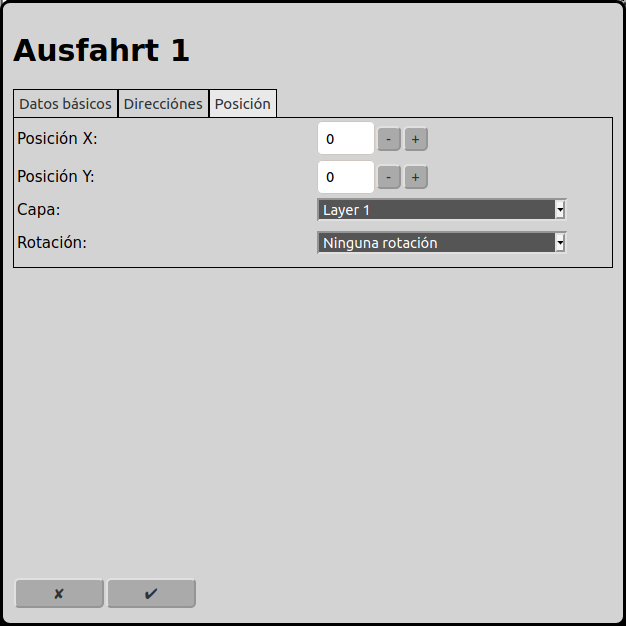

# Configuración de las señales
En la pantalla principal se puede ir a la configuración de las señales con el icono .

## Datos básicos

### Nombre
Cada señal necesita un nombre inequívoco. Si el nombre no está indicado, RailControl crea un nombre. Si el nombre ya existe, RailControl añade un número al nombre para hacerlo inequívoco.

### Orientación
Obsoleto. Solamente se muestra si ya hay señales configuradas como inicio o destino en una ruta. Se eliminará en versiones futuras.

Por favor, reemplaza esta señal con una vía en la ruta y asocia esta señal con la vía.

### Control
Si hay más de un control configurado en RailControl, se tiene que seleccionar el control que controla la señal. Si solamente hay un control configurado en RailControl, el campo de selección no está visible.

### Tipo
RailControl conoce los siguientes tipos de señales (otros tipos siguen):

Simple izquierda: Esta señal conoce solamente los dos aspectos "parada" y "vía libre". La señal está posicionada a la izquierda de la vía.

Simple derecha: Esta señal conoce solamente los dos aspectos "parada" y "vía libre". La señal está posicionada a la derecha de la vía.

Suiza enana: La señal enana de Suiza conoce los aspectos "parada", "vía libre" y "cuidado". Vea también: Swiss railway signaling.

Suiza L principal: La señal principal tipo L de Suiza conoce los aspectos "parada", "vía libre", "40 km/h", "60 km/h", "90 km/h" y "vía libre corta". Vea también: Swiss railway signaling.

Alemania Ks: La señal Ks conoce los aspectos "parada", "vía libre", "maniobrar", "cuidado", "oscura" y "parada esperada".

### Longitud
Obsoleto. Solamente se muestra si ya hay señales configuradas como inicio o destino en una ruta. Se eliminará en versiones futuras.

Por favor, reemplaza esta señal con una vía en la ruta y asocia esta señal con la vía.

### Control
Si hay más de un control configurado en RailControl, se tiene que seleccionar el control que controla la señal. Si solamente hay un control configurado en RailControl, el campo de selección no está visible.

### Protocolo
Si un control soporta más de un protocolo, se tiene que seleccionar el protocolo que controla la señal. Si el control solamente soporta un protocolo, el campo de selección no está visible.

### Dirección básica
La dirección básica que controla la señal. En "Direcciones" se puede introducir la dirección de cada aspecto de la señal. La dirección básica es la dirección más baja que se puede usar.

### Duración de conmutación (ms)
Después del procedimiento de conmutación se tienen que apagar los accesorios. Para accesorios nuevos suelen bastar 100ms. A veces accesorios más viejos o lentos necesitan 250ms. Algunos controles apagan los accesorios automáticamente con un valor que se puede configurar directamente en el control. En este caso se puede configurar 0ms aquí.

### Invertido
Cuando las conexiones del accesorio están conectadas al revés, RailControl puede invertirlas virtualmente.

## Direcciones

Según el tipo de señal elegido en "Datos básicos", los aspectos posibles se muestran aquí. Para cada aspecto se puede elegir una dirección. La dirección más baja es la dirección básica elegida en "Datos básicos". Por defecto, las direcciones se eligen en orden ascendente empezando con la dirección básica.

## Posición

 
### Posición X
La posición del elemento en cuadros desde la izquierda en el diagrama de vías. Se empieza a contar con cero. Si un elemento es más grande que un cuadrado, el cuadrado superior izquierdo es importante para contar.

### Posición Y
La posición del elemento en cuadros desde arriba en el diagrama de vías. Se empieza a contar con cero. Si un elemento es más grande que un cuadrado, el cuadrado superior izquierdo es importante para contar.

### Capa
La capa en que el elemento está visible.

### Rotación
Se puede rotar los elementos en pasos de 90 grados.

## Retroseñales
Obsoleto. Solamente se muestra si ya hay retroseñales configuradas. Se eliminará en versiones futuras.

Por favor, elimina las retroseñales configurado.

### Modo automático
Obsoleto. Solamente se muestra si ya hay señales configuradas como inicio o destino en una ruta. Se eliminará en versiones futuras.

Por favor, reemplaza esta señal con una vía en la ruta y asocia esta señal con la vía.

