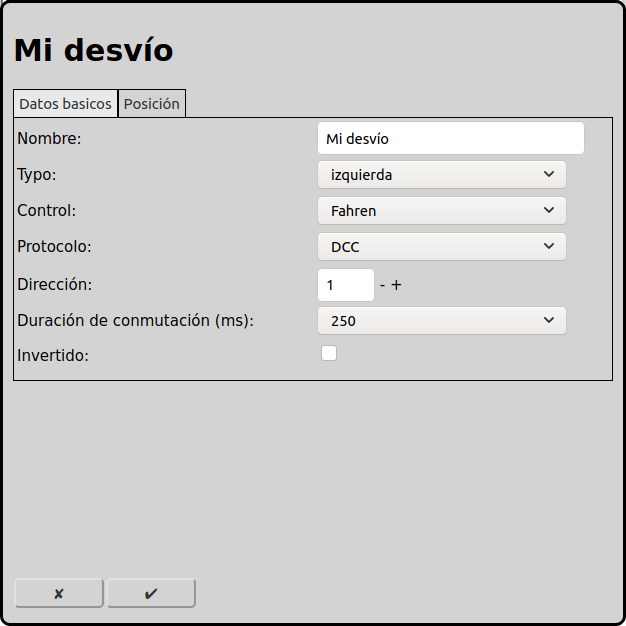
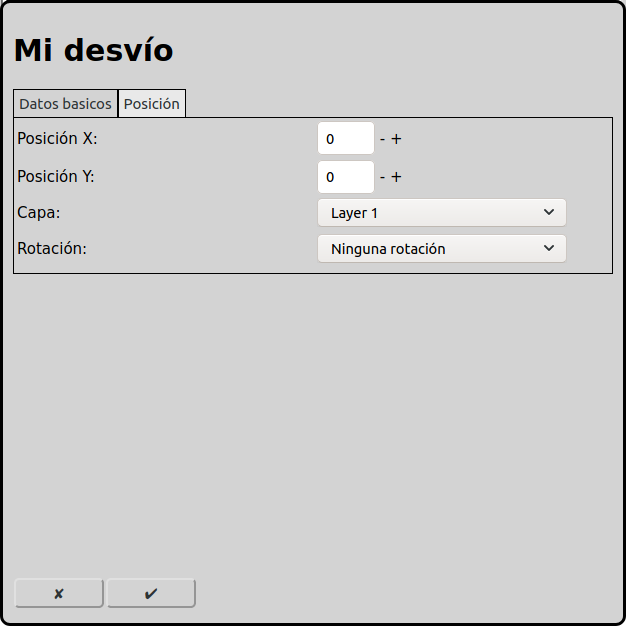

# Configuración de los desvíos
En la pantalla principal se puede ir a la configuración de los desvíos con el icono .

## Datos básicos

### Nombre
Cada desvío necesita un nombre inequívoco. Si el nombre no está indicado, RailControl crea un nombre. Si el nombre ya existe, RailControl añade un número al nombre para hacerlo inequívoco.

### Tipo
RailControl conoce varios tipos de desvíos:

izquierda: En el diagrama de vías se muestra el elemento como un desvío a la izquierda. El símbolo no tiene que ser igual al tipo de desvío en la maqueta.

derecha: En el diagrama de vías se muestra el elemento como un desvío a la derecha. El símbolo no tiene que ser igual al tipo de desvío en la maqueta.

tres vías: Este tipo representa dos desvíos en el mismo lugar. Una de las cuatro posiciones lógicas no existe en la realidad. RailControl no permite esta posición. El desvío izquierdo está controlado por la dirección seleccionada, y el desvío derecho está controlado por la dirección siguiente.

Märklin desvío de cruce doble izquierda: Los desvíos de cruce doble de Märklin solamente requieren un motor.

Märklin desvío de cruce doble derecha: Los desvíos de cruce doble de Märklin solamente requieren un motor.

Se pueden configurar los desvíos de cruce doble con dos motores como dos desvíos simples. Es importante que el motor físico a la izquierda sea controlado por el desvío a la derecha en RailControl.

### Control
Si hay más de un control configurado en RailControl, se tiene que seleccionar el control que controla el desvío. Si solamente hay un control configurado en RailControl, el campo de selección no está visible.

### Protocolo
Si un control soporta más de un protocolo, se tiene que seleccionar el protocolo que controla el desvío. Si el control solamente soporta un protocolo, el campo de selección no está visible.

### Dirección
La dirección que controla el desvío.

### Duración de conmutación (ms)
Después del procedimiento de conmutación se tienen que apagar los accesorios. Para accesorios nuevos suelen bastar 100ms. A veces accesorios más viejos o lentos necesitan 250ms. Algunos controles apagan los accesorios automáticamente con un valor que se puede configurar directamente en el control. En este caso se puede configurar 0ms aquí.

### Invertido
Cuando las conexiones del accesorio están conectadas al revés, RailControl puede invertirlas virtualmente.

## Posición

### Posición X
La posición del elemento en cuadros desde la izquierda en el diagrama de vías. Se empieza a contar con cero. Si un elemento es más grande que un cuadrado, el cuadrado superior izquierdo es importante para contar.

### Posición Y
La posición del elemento en cuadros desde arriba en el diagrama de vías. Se empieza a contar con cero. Si un elemento es más grande que un cuadrado, el cuadrado superior izquierdo es importante para contar.

### Capa
La capa en que el elemento está visible.

### Rotación
Se puede rotar los elementos en pasos de 90 grados.

