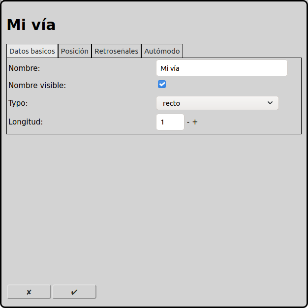
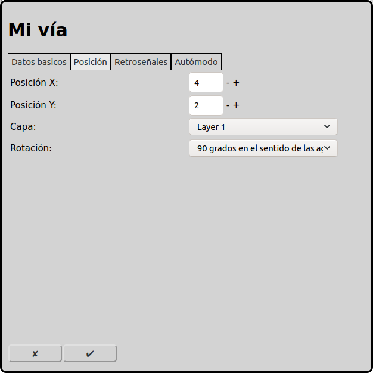
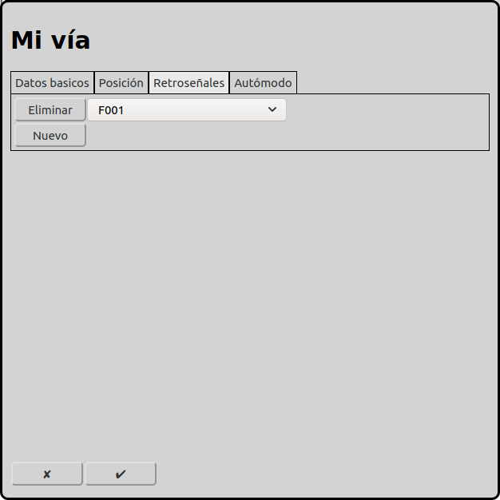
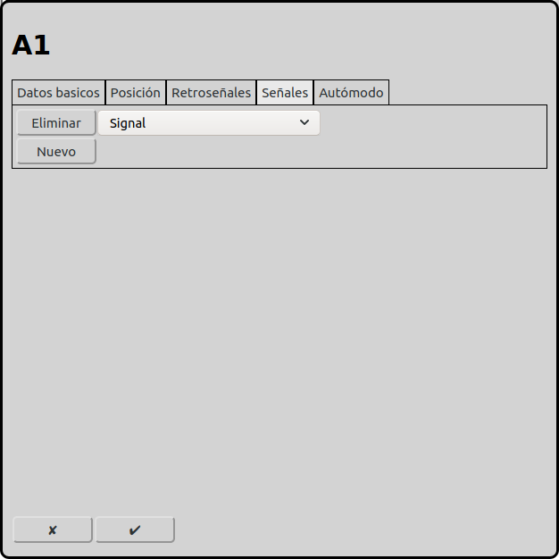
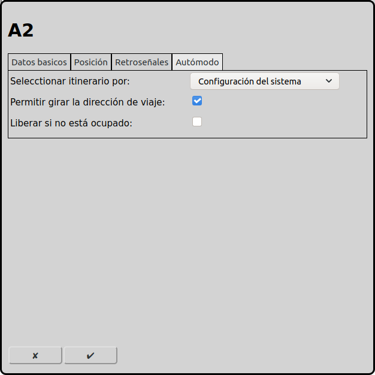

# Configuración de las vías
En la pantalla principal se puede ir a la configuración de las vías con el icono .

En el diagrama de vías, los elementos de vía son muy importantes. Con los elementos de vía se puede diseñar el diagrama. También son muy importantes en el modo automático, porque todos los itinerarios empiezan o terminan en una vía.

## Datos básicos

### Tipo
RailControl conoce distintos tipos de vías:

recto: Una vía recta. Se recomienda usarla para el inicio o destino de itinerarios. Principalmente también se pueden usar todos los otros tipos de vías.

curvo: Una vía que está en diagonal en el diagrama de vías.

Final / Tope: Significa el fin de una vía o un tope.

Puente: Significa un puente.

Túnel (dos lados): Significa un túnel. Los dos portales forman parte del elemento. No se pueden usar los cuadros vacíos entre los portales para otros elementos.

Túnel (un lado): Significa un túnel. Tiene sentido usar dos de estos elementos.

Enlace: Significa una vía que continúa en otra capa.

Intersección izquierda: Significa un cruce simple sin desvío. Hay una vía recta y una vía diagonal.

Intersección derecha: Significa un cruce simple sin desvío. Hay una vía recta y una vía diagonal.

Intersección simétrica: Significa un cruce simple sin desvío. Hay dos vías diagonales.

### Vía principal
Especialmente en el modo automático, una sección/bloque de vía puede extenderse a lo largo de varias secciones físicas de vía, como puentes y túneles. En este caso, tiene sentido definir una vía principal y adjuntarle las otras vías. Esta vía adjunta se comporta de forma idéntica a la vía principal, es decir, tiene los mismos menús contextuales y la misma iluminación que la vía principal.

### Nombre
Cada vía necesita un nombre inequívoco. Si el nombre no está indicado, RailControl crea un nombre. Si el nombre ya existe, RailControl añade un número al nombre para hacerlo inequívoco.

### Nombre visible
Se puede seleccionar si se muestra el nombre de una vía recta. Si la vía es el inicio o el destino de un itinerario, tiene sentido mostrar el nombre. En la mayoría de los casos, para la operación manual los nombres no son importantes.

### Nombre mostrado
Este texto se muestra como descripción en la vista general. El nombre mostrado no tiene que ser inequívoco. Si este campo está vacío, se muestra el texto indicado como nombre.

### Longitud
Algunos tipos de vías permiten seleccionar la longitud. Es el número de cuadros utilizados para mostrar la vía en el diagrama de vías.

## Posición

### Posición X
La posición del elemento en cuadros desde la izquierda en el diagrama de vías. Se empieza a contar con cero. Si un elemento es más grande que un cuadrado, el cuadrado superior izquierdo es importante para contar.

### Posición Y
La posición del elemento en cuadros desde arriba en el diagrama de vías. Se empieza a contar con cero. Si un elemento es más grande que un cuadrado, el cuadrado superior izquierdo es importante para contar.

### Capa
La capa en que el elemento está visible.

### Rotación
Se puede rotar los elementos en pasos de 90 grados.

## Retroseñales

Se pueden asignar una o más retroseñales a cada vía. Las retroseñales indican la ocupación de la vía. En el modo automático, la vía de destino de los itinerarios requiere una retroseñal asignada.

## Señales

Se pueden asociar una o más señales a una vía. Las señales asociadas se ponen en indicación de parada cuando un itinerario saliente se libera o cuando en modo automático está seleccionado "Liberar si no está ocupado" y la vía está libre (todas las retroseñales están libres).

## Modo automático

 
### Seleccionar itinerario por
En el modo automático RailControl tiene que seleccionar un itinerario para usar. Si hay más itinerarios disponibles, RailControl tiene que elegir una posibilidad. Se puede configurar cómo RailControl elige un itinerario.

Configuración del sistema: Se usa la configuración de las [Opciones generales](#opciones-generales).

No importa: No importa qué itinerario se usa. Normalmente se usa el mismo itinerario.

Aleatorio: Se elige el itinerario al azar.

Vía más corta: Se usa el itinerario con la vía de destino más corta.

El más largo sin usar: Se usa el itinerario que no estuvo usado por el tiempo máximo.

### Permitir invertir la dirección de marcha de la locomotora
Se puede permitir cambiar la orientación de marcha en esta vía. Además, se necesita un itinerario en la otra dirección y la locomotora debe estar configurada como tren push-pull.

Esto tiene sentido en una estación donde los trenes push-pull cambian el sentido de marcha.

### Liberar si no está ocupado

Se puede liberar una vía cuando todas las retroseñales se han desactivado. Así se puede usar la vía de inicio para el próximo tren, aunque el primer tren todavía no haya llegado a la vía de destino.

Esta opción solamente tiene sentido cuando las vías están supervisadas completamente con circuitos de vía, contadores de ejes u otros métodos que detectan si una vía está libre.

