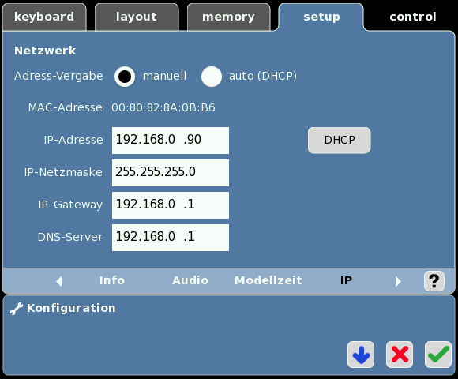
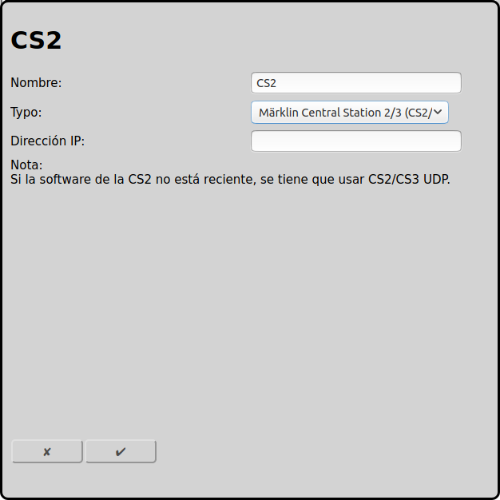

## Märklin Central Station 2/3 (CS2/3) con TCP (reciente) {#märklin-central-station-23-cs23-con-tcp-reciente}

La nueva conexión entre RailControl y Märklin CS2/CS3 es TCP. Está explicada en esta página.

La antigua [opción UDP](#märklin-central-station-23-cs23-con-udp-anticuado) no está recomendada.

### Configuración CS2/CS3

En Setup/Configuración/IP es necesario introducir la dirección IP y la máscara de red. La dirección IP es la IP necesaria para la configuración posterior de RailControl. IP-Gateway y servidor DNS solamente son importantes para la actualización del software.

### Configuración RailControl

El nombre solamente es importante para reconocer el control, especialmente si hay más de uno. Después sólo se tiene que introducir la IP de la CS2/CS3:

### Configuración Firewall

Normalmente la configuración por defecto es suficiente. Solamente el puerto TCP 15731 para datos salientes tiene que estar abierto.

