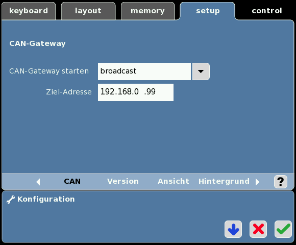
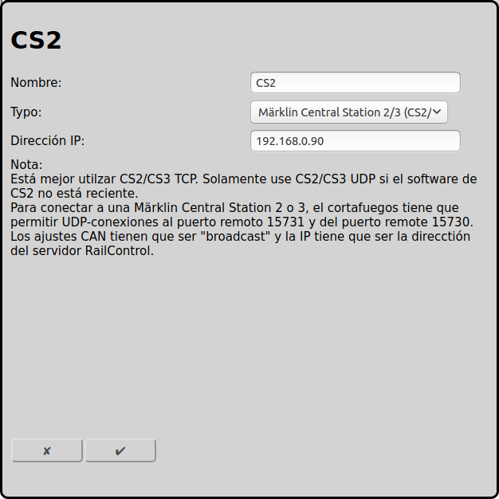

## Märklin Central Station 2/3 (CS2/3) con UDP (anticuado) {#märklin-central-station-23-cs23-con-udp-anticuado}

La antigua opción de conexión entre RailControl y Märklin CS2/CS3 es UDP. Está explicada en esta página.

La nueva opción de [conexión TCP](#märklin-central-station-23-cs23-con-tcp-reciente) es mejor.

### Configuración CS2/CS3

En Setup/Configuración/IP es necesario introducir la dirección IP y la máscara de red. La dirección IP es la IP necesaria para la configuración posterior de RailControl. IP-Gateway y servidor DNS solamente son importantes para la actualización del software.

La CS2/CS3 tiene que saber cómo conectarse a RailControl. En el menú CAN-Gateway se tiene que introducir la dirección IP del servidor RailControl (en este ejemplo 192.168.0.99).

### Configuración RailControl

El nombre solamente es importante para reconocer el control, especialmente si hay más de uno. Después sólo se tiene que introducir la IP de la CS2/CS3:

### Configuración Firewall

Normalmente la configuración por defecto es suficiente. Solamente el puerto TCP 15731 para datos salientes tiene que estar abierto. El cortafuegos tiene que aceptar conexiones UDP de RailControl al puerto 15731 de la CS2/CS3 y conexiones UDP de la CS2/CS3 al puerto 15730 de RailControl. Si la red no está conectada a internet, es más fácil apagar el cortafuegos.

