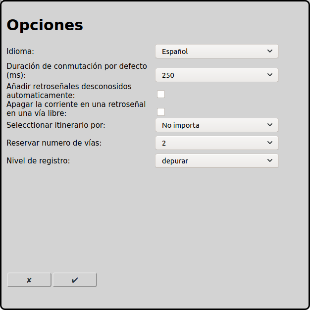

# Opciones generales
Para usar RailControl algunas opciones son necesarias.

En la pantalla principal se puede ir a la configuración de las opciones con el icono :

## Datos básicos
### Idioma
Se puede seleccionar el idioma. Todos los textos se muestran en este idioma.

### Nivel de registro
El nivel de registro que RailControl escribe acciones.

Errores: Sólo se registran errores graves.

Advertencias: También se registran advertencias que probablemente impidan una ejecución correcta de RailControl.

Informaciones: Se registran todas las acciones importantes. Esta opción está recomendada.

Depurar: Se registran todas las acciones. Esta opción es especialmente útil para la búsqueda de errores.

## Iniciar
### Inicialización de las locomotoras
Las locomotoras pueden inicializarse al iniciar RailControl. La velocidad se establece en 0 para todas las locomotoras y las funciones se establecen en los últimos estados conocidos.

Sin inicialización: Las locomotoras no se inicializan al arrancar RailControl.

Sólo velocidad: La velocidad de las locomotoras se pone a 0 al arrancar RailControl.

Velocidad y funciones: La velocidad de las locomotoras se pone a 0 al arrancar RailControl y las funciones se establecen a los últimos estados conocidos.

## Retroseñal
### Añadir retroseñales desconocidas automáticamente
La mayoría de los controles informan automáticamente a RailControl de [retroseñales](#configuración-de-las-retroseñales) activadas sin configurar en RailControl. RailControl puede usar esta información para configurarlas automáticamente.

### Apagar la corriente en una retroseñal en una vía libre
RailControl puede apagar la corriente y bloquear una vía, si una retroseñal está activada en esta vía pero RailControl no espera un tren.

## Accesorio
### Duración de conmutación por defecto (ms)
Después del procedimiento de conmutación se tienen que apagar los accesorios. Para accesorios nuevos suelen bastar 100ms. Accesorios más viejos o lentos a veces necesitan 250ms. Algunos controles apagan los accesorios automáticamente con un valor que se puede configurar directamente en el control. En este caso se puede configurar 0ms aquí.

### Conmutar accesorios
si en posición incorrecta: RailControl sólo envía una orden de conmutación al control si el accesorio está en la posición incorrecta.

siempre: RailControl siempre envía una orden de conmutación al control, independientemente de la posición del accesorio.

## Modo automático
### Seleccionar itinerario por
En el modo automático RailControl tiene que elegir qué itinerario usar. Hay diferentes conceptos disponibles. Los itinerarios en uso nunca se eligen.

No importa: Se elige un itinerario cualquiera. Normalmente siempre se elige el mismo itinerario.

Vía más corta: Se elige el itinerario con la vía de destino más corta.

El más largo sin usar: Se elige el itinerario que lleva más tiempo sin usarse.

### Reservar número de vías
El número de itinerarios que están reservados en el modo automático. Si se reserva solamente un itinerario, el tren se detiene al final de cada itinerario.

