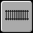
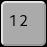
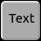

# Descargar
Se puede descargar RailControl de la página [Download](https://www.railcontrol.org/index.php/es/download-es).

## Instalación
Se puede extraer el archivo descargado en cualquier lugar de la computadora.

### Instalación en Windows
En Windows se tiene que extraer el archivo en una subcarpeta. D:\\ no vale, D:\\Modelismo está bien.

### Instalación en Debian GNU/Linux

Desde Debian GNU/Linux 13 "trixie", RailControl está incluido en Debian. Se puede instalar con este comando:

```
sudo apt install railcontrol
```

**Nota:** La documentación específica de Debian se encuentra en el directorio
`/usr/share/doc/railcontrol`.

## Fichero de la configuración
En el archivo extraído hay una plantilla de archivo de configuración (railcontrol.conf.dist). Durante el primer inicio de RailControl, la plantilla se copia a railcontrol.conf. Normalmente no es necesario cambiar nada en el archivo de configuración.

## Arrancar RailControl
Con un doble clic en railcontrol.exe (Windows) o railcontrol (otros sistemas) se puede poner en marcha RailControl. Se recomienda utilizar RailControl en un terminal para recibir más información sobre RailControl. También en un terminal se puede cambiar el funcionamiento de RailControl con argumentos de inicio.

## Terminar RailControl
Se puede terminar RailControl introduciendo q+Enter o Ctrl+C en el terminal de RailControl, o usando el botón en el navegador de internet.

**Importante: Usar la X arriba a la derecha del terminal de RailControl puede causar problemas al guardar los ajustes y al arrancar RailControl otra vez.**

Introducir q+Enter o Ctrl+C en el terminal, o usar el botón en el navegador varias veces, terminará RailControl inmediatamente. Use esta opción solamente si RailControl no termina correctamente.

## Navegador Internet
Después de poner RailControl en marcha, se puede conectar a RailControl con un navegador de internet actual. RailControl muestra los enlaces posibles durante el inicio. Se puede copiar uno de los enlaces al navegador de internet. Los enlaces con localhost, 127.0.0.1 y [::1] solamente funcionan en el mismo dispositivo que RailControl.

# Funciones y configuración
Las funciones importantes y la configuración son accesibles en la barra de menú:

Desde la izquierda hasta la derecha son:

| | |
|---|---|
|  | Terminar el servidor RailControl (parando todos los trenes) |
|  | Encender y apagar la corriente de vía |
|  | Parar todos los trenes inmediatamente (velocidad cero) |
|  | Parar todos los trenes en modo automático al final del itinerario |
|  | Poner todos los trenes en el modo automático |
|  | Mostrar RailControl en modo pantalla completa |
|  | Programación CV. Se muestra solamente si el control y su API lo admiten |
|  | En pantallas estrechas se puede mostrar la segunda parte del menú |
|  | [Opciones generales](#opciones-generales) |
|  | [Configuración de los controles](#configuración-de-controles) |
|  | [Configuración de las locomotoras](#configuración-de-las-locomotoras) |
|  | [Configuración de las unidades múltiples](#configuración-de-las-unidades-múltiples) |
|  | [Configuración de las capas](#configuración-de-las-capas) |
|  | [Configuración de las vías](#configuración-de-las-vías) |
|  | [Configuración de los grupos de vía](#configuración-de-los-grupos-de-vía) |
|  | [Configuración de los desvíos](#configuración-de-los-desvíos) |
|  | [Configuración de las señales](#configuración-de-las-señales) |
|  | [Configuración de los accesorios](#configuración-de-los-accesorios) |
|  | [Configuración de las retroseñales](#configuración-de-las-retroseñales) |
|  | [Configuración de los itinerarios](#configuración-de-los-itinerarios) |
|  | [Configuración de los contadores](#configuración-de-los-contadores) |
|  | [Configuración de los textos](#configuración-de-los-textos) |

